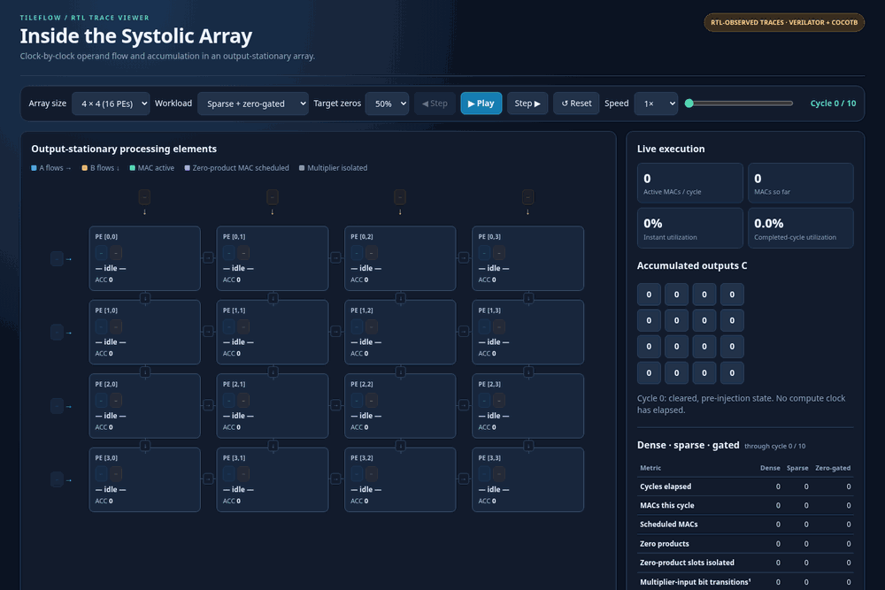

# TileFlow

A parameterized **output-stationary systolic array** in SystemVerilog, with cocotb verification, cycle-by-cycle RTL visualization, and an evaluated zero-gated datapath.

[](https://ismail9889.github.io/tileflow/)

*4×4 array · 50% target input zeros · cycles 0–10. Animated preview captured from the standalone **RTL-observed** viewer; playback timing is illustrative.*

**Interactive Demo:** [Open the standalone viewer](docs/index.html) locally, or [publish it with GitHub Pages](#publishing-the-demo).

## Design

Each processing element forwards operand A rightward and B downward while accumulating a stationary output. The default datapath uses **signed INT8 operands** and **INT32 accumulators**. Inputs are skewed at the array boundaries; an `N × N` multiplication completes in **`3N − 2` compute edges**.

The RTL is compiled with `ZERO_GATE=0` (conventional) or `ZERO_GATE=1` (operand isolation). The viewer compares independently simulated configurations:

| Workload | Behavior |
| --- | --- |
| Dense | Conventional multiplication with nonzero inputs |
| Sparse | Zeros traverse the normal MAC schedule |
| Sparse + zero-gated | Multiplier operands are isolated for zero-product slots; forwarding and timing are unchanged |

Supported demonstration sizes: **2×2, 3×3, 4×4, 8×8**. Zero-gating is a **compile-time** parameter, not a runtime switch in the hardware.

## Measured example

For **4×4**, using the *same sparse A and B matrices* with **50% target input zeros**:

| Measurement | Conventional sparse | Zero-gated sparse |
| --- | ---: | ---: |
| Compute edges | 10 | 10 |
| Scheduled MAC slots | 64 | 64 |
| Sampled multiplier-input bit transitions | 472 | 248 |
| Yosys generic cells | 17,520 | 18,245 |

The gated design produced **47.46% fewer sampled multiplier-input transitions**, with **4.14% more generic synthesis cells**. These are **not** measured power savings, physical area, or speedup. The generic-cell counts include debug observation logic and gating-pulse registers; the switching counts sample multiplier-input buses at compute edges rather than internal gate glitches. Workloads are small, deterministic demonstrations, not representative benchmarks. Full results for the four array sizes and three target sparsity levels are provided as [synthesis CSV](results/generic_cells.csv) and [switching CSV](results/switching_comparison.csv).

## Measurement method

Each 2×2, 3×3, 4×4, and 8×8 configuration is independently simulated with `ZERO_GATE=0` and `ZERO_GATE=1`. The switching comparison uses the same deterministic sparse matrix pair at each target zero level (25%, 50%, 75%); actual zero density can differ slightly for small matrices. The analyzer checks matched operands, output values, partial sums, MAC schedules, and gating markers across all 12 sparse/gated comparisons.

For each PE, the switching proxy counts bit differences between successive sampled multiplier-input buses just before compute edges (initial samples compared with zero). These counts exclude internal multiplier glitches, clock activity, and all other nodes. Synthesis uses the same Yosys flow for both configurations (`synth -auto-top -flatten -noabc`, `W=8`, `ACC_W=32`), excludes `$scopeinfo` metadata, and includes instrumentation ports and gating-pulse registers. Neither measurement establishes physical area, power, energy, or clock-frequency improvements.

## Reproduce

Requires Linux or Ubuntu/WSL, Python 3.11–3.13, Verilator 5+, and a C++ compiler. The recorded experiments used Verilator 5.032, cocotb 2.0.1 and Yosys 0.52 (Yosys is optional unless reproducing synthesis numbers).

```bash
python3 -m venv .venv
source .venv/bin/activate
python -m pip install -r requirements.txt

python -m unittest discover -s tests -p 'test_model.py' -v
python -m unittest discover -s tests -p 'test_evaluation.py' -v
python tools/run_rtl.py --sizes 2 3 4 8
python tools/compare_switching.py --sizes 2 3 4 8
python tools/build_demo.py --rtl
```

Open `artifacts/rtl_demo.html` locally. The synthesis comparison is optional:

```bash
python tools/measure_synth.py --sizes 2 3 4 8
```

Reports are generated in `build/reports/`. The versioned CSV snapshots are in [`results/`](results/); generated simulator outputs are deliberately excluded from Git.

**Verification:** The recorded local regression passed eight cocotb configurations (four sizes × two RTL variants), six Python model tests, and four analysis tests. The trace-pair analyzer validated 12 matched sparse/gated cases, including identical inputs, MAC schedules, outputs and isolation markers. [GitHub Actions](.github/workflows/verify.yml) reruns the model and RTL checks and checks the published demo and switching snapshot; its status must be verified after the first push.

## Source layout

`rtl/` — synthesizable SystemVerilog · `sim/` — Python reference model · `tests/` — cocotb and analysis tests · `tools/` — simulation and evaluation scripts · `viewer/` — editable HTML/CSS/JS · `results/` — measurement snapshots · `docs/` — standalone GitHub Pages viewer and animated preview.

